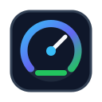
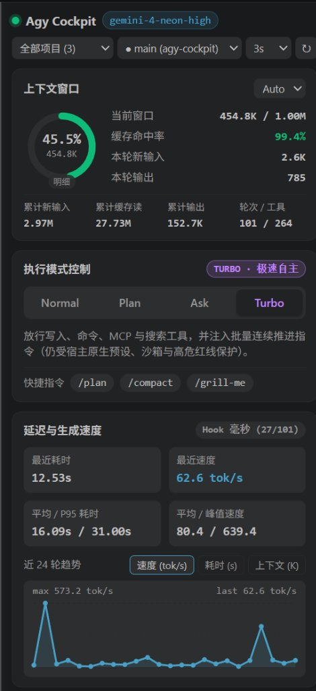
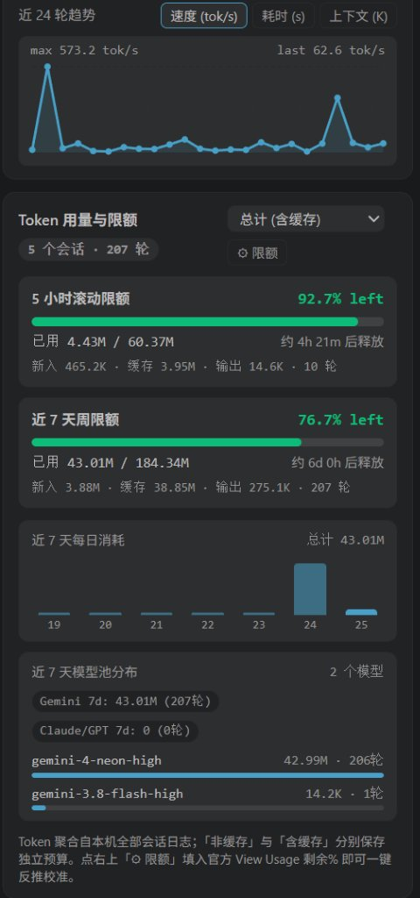
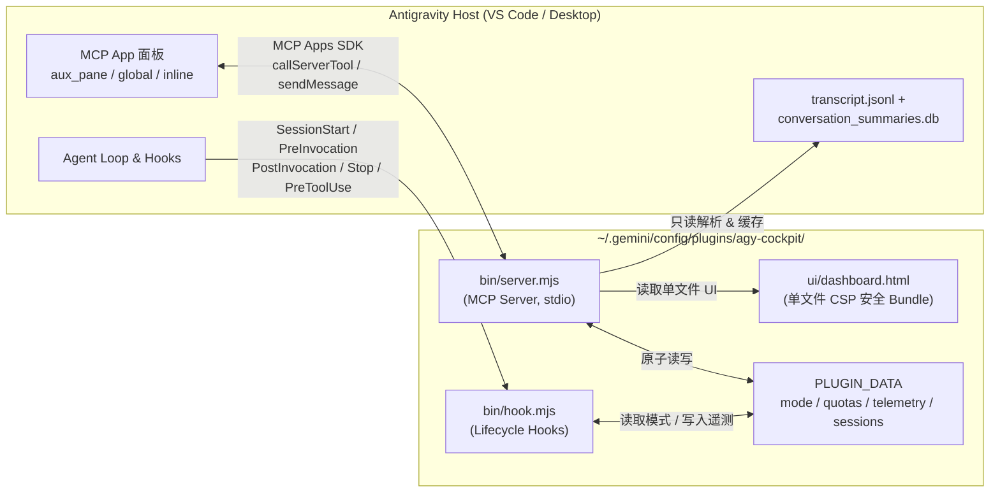

<div align="center">



<h1>Agy Cockpit</h1>

<p><strong>Google Antigravity 状态监控与模式控制驾驶舱插件</strong></p>

<p>
  实时上下文窗口圆环与占用明细 · 缓存命中率 · 延迟与速度曲线 · 5h / 7d Token 用量限额 · Auto / Plan / Ask / Turbo 模式切换
</p>

<p>
  
  <a href="https://github.com/muamuauh/agy-cockpit/actions/workflows/ci.yml">
    
  </a>
  <a href="./LICENSE">
    
  </a>
  
  
  
</p>

<p>
  <strong>简体中文</strong> | <a href="./README_EN.md">English</a>
</p>

<p>
  <a href="#界面预览">界面预览</a> |
  <a href="#核心功能">核心功能</a> |
  <a href="#执行模式说明">执行模式</a> |
  <a href="#快速安装">快速安装</a> |
  <a href="#架构设计">架构设计</a> |
  <a href="#开发与测试">开发与测试</a> |
  <a href="#隐私与卸载">隐私与卸载</a>
</p>

</div>

---

> **设计理念**：完全基于 Antigravity 官方扩展体系（**MCP App + Lifecycle Hooks + Native Plugin**）构建，**不修改客户端二进制文件、不注入原生 DOM、不探测未公开内部接口**。一套插件同时兼容 **VS Code Antigravity 扩展** 与 **Antigravity 2.0 桌面端**，构建产物打包为单文件 Bundle，运行时零 `node_modules` 依赖。

## 界面预览

<div align="center">
  <table>
    <tr>
      <td align="center" valign="top">
        
        <br />
        <sub><strong>上下文窗口 · 执行模式 · 延迟与速度曲线</strong></sub>
      </td>
      <td align="center" valign="top">
        
        <br />
        <sub><strong>5h / 7d Token 限额 · 每日消耗 · 模型池分布</strong></sub>
      </td>
    </tr>
  </table>
</div>

## 核心功能

| 模块 | 核心能力 |
| :--- | :--- |
| **上下文窗口监测 + 悬停明细** | SVG 环形进度条（`<60%` 绿 / `60%–85%` 黄 / `≥85%` 红）、精确 `已用 / 上限`、缓存命中率与累计消耗；**悬停或点击圆环**展开四色构成明细（系统指令 & 工具定义、工具输出 / 文件内容、模型回复 & 调用参数、用户 & 系统消息）、压缩次数、续航轮数估算与 Top 工具消耗溯源。 |
| **项目 / 会话二级联动** | 只读解析本地 `conversation_summaries.db` 与会话日志，自动过滤子代理与 `/btw` 临时侧边问答，仅保留真实项目会话；支持顶栏 **「项目筛选 → 会话切换」** 单行紧凑联动，超长标题自动省略并保留悬停完整提示。 |
| **四档执行模式控制** | 面板一键切换 **`Auto` / `Plan` / `Ask` / `Turbo`**，由 `hooks.json` 实时生效；模式写入工具声明为 `visibility: ["app"]`，**模型不可见也无法自行篡改**；右侧栏支持一键发送 `/plan`、`/compact`、`/grill-me` 快捷指令。 |
| **延迟与生成速度趋势** | 结合 Hook 毫秒级计时与日志纯模型耗时（自动过滤工具/人工审批长等待污染），展示最近/平均/P95 耗时与最近/平均/峰值 `tok/s`，并提供 1:1 像素自适应 SVG 近 24 轮趋势图（速度 / 耗时 / 上下文一键切换）。 |
| **5h / 7d Token 用量与限额** | 跨本机全部会话聚合 **5 小时滚动窗口**、**近 7 天周窗口** 与全量累计 Token，展示 `XX% left` 剩余进度条、滚动释放倒计时、7 天每日柱状图与 `Gemini` / `Claude & GPT` 模型池分布；支持独立保存「非缓存 / 含缓存」预算，并可填入原生 `View Usage` 剩余% 一键反推校准。 |

---

## 执行模式说明

Agy Cockpit 的模式开关位于 Antigravity 原生 `Global Permissions` 之上，两者为**上下串联关系**（插件层可随时收紧权限，但不会突破宿主本身的终端沙箱、工作区外访问与 Deny List 硬边界）：

| 模式 | 徽章 | `PreInvocation` | `PreToolUse` | 适用场景 |
| :--- | :---: | :--- | :--- | :--- |
| **`Auto`** | 默认自动 | 记录会话与计时 | 返回 `allow`，交由宿主原生预设与沙箱把关 | 日常默认使用 |
| **`Plan`** | 只读规划 | 注入只读规划系统指令 | 对 `edit_file` / `write_file` / `run_command` 返回 `deny` 硬拦截 | 架构设计、高风险仓库只读调研 |
| **`Ask`** | 步步确认 | 记录会话与计时 | 对写入与命令工具返回 `force_ask`（忽略 Always Allow 缓存） | 关键代码/生产脚本谨慎改动 |
| **`Turbo`** | 极速自主 | 注入批量并行、连续推进指令（仍守高危操作红线） | 放行写入、命令、MCP 与搜索工具 | 工作区内高效连续开发（推荐搭配底层原生 `Auto`） |

---

## 快速安装

### 环境要求
- **Node.js `>= 20`**（推荐 `>= 22.5` 以启用内置 `node:sqlite` 读取官方会话标题与项目名；低版本会自动降级解析日志首行）
- 已安装 **Antigravity VS Code 扩展** 或 **Antigravity 2.0 桌面端**

### 方式一：让 Antigravity Agent 自动安装
直接把下面这句话发给 Antigravity 即可：

```text
请帮我克隆并安装 Agy Cockpit 插件：https://github.com/muamuauh/agy-cockpit
克隆到本地后依次执行 npm install、npm run test 和 npm run install-plugin，然后帮我刷新 MCP Server。
```

### 方式二：手动安装

```bash
git clone https://github.com/muamuauh/agy-cockpit.git
cd agy-cockpit
npm install
npm run install-plugin
```

执行完成后，插件产物会自动同步到：
- **Windows**：`%USERPROFILE%\.gemini\config\plugins\agy-cockpit\`
- **macOS / Linux**：`~/.gemini/config/plugins/agy-cockpit/`

### 打开面板
1. **右侧辅助栏（推荐，可常驻）**：点击聊天区右侧辅助栏 **`+`** → 选择 **`Agy Cockpit`**；
2. **左侧边栏全页视图**：点击左侧边栏 **`Agy Cockpit`**；
3. **对话内联唤起**：直接在对话中说「打开 Agy Cockpit」。

> 首次安装后，如左侧/右侧入口未立即出现，在 **Customizations → Installed** 确认 `agy-cockpit` 已启用，或新开一个会话即可加载 `hooks.json` 与 MCP Server。

---

## 架构设计



### 目录结构

```text
agy-cockpit/
├── assets/
│   └── logo.svg                 # 插件图标
├── plugin/
│   ├── plugin.json              # Antigravity 插件清单
│   ├── mcp_config.json          # MCP Server 配置 (${PLUGIN_ROOT} / ${PLUGIN_DATA})
│   └── hooks.json               # 生命周期 Hook 注册
├── scripts/
│   └── build.mjs                # esbuild 打包与原地热更新安装脚本
├── src/
│   ├── hook/hook.mjs            # 零依赖 Hook 控制器
│   ├── server/
│   │   ├── index.mjs            # MCP Server (open_cockpit / snapshot / mode / quotas)
│   │   └── telemetry.mjs        # 会话发现、SQLite 标题解析、上下文拆解与 5h/7d 聚合
│   ├── shared/state.mjs         # 状态与配置原子持久化层
│   └── ui/
│       ├── template.html        # 单页仪表盘模板
│       ├── styles.css           # 宿主主题自适应样式
│       └── app.ts               # MCP App 前端交互逻辑
└── tests/
    ├── hook.test.mjs            # Hook 四模式与延迟落盘测试
    ├── telemetry.test.mjs       # 上下文拆解、过滤、防工具等待失真与用量分桶测试
    └── mcp_smoke.test.mjs       # MCP 协议端到端冒烟测试
```

---

## 开发与测试

```bash
# 仅构建打包至 dist/plugin/
npm run build

# 运行全套单元测试与 MCP 端到端冒烟测试
npm test

# 重新构建并原地热同步至 ~/.gemini/config/plugins/agy-cockpit/
npm run install-plugin
```

---

## 隐私与卸载

- **100% 本地只读**：所有上下文、会话标题、延迟与 Token 统计均在本地读取 `~/.gemini/` 日志与只读 SQLite 计算，**不发起任何外网请求**，前端满足严格 CSP。
- **卸载插件**：可在 Antigravity 的 **Customizations → Installed** 页面关闭或移除 `agy-cockpit`，或直接删除插件目录：

```powershell
# Windows (PowerShell)
Remove-Item -Recurse -Force "$env:USERPROFILE\.gemini\config\plugins\agy-cockpit"
```

```bash
# macOS / Linux
rm -rf ~/.gemini/config/plugins/agy-cockpit
```

---

## License

[MIT](./LICENSE) © 2026 [muamuauh](https://github.com/muamuauh)
