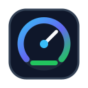
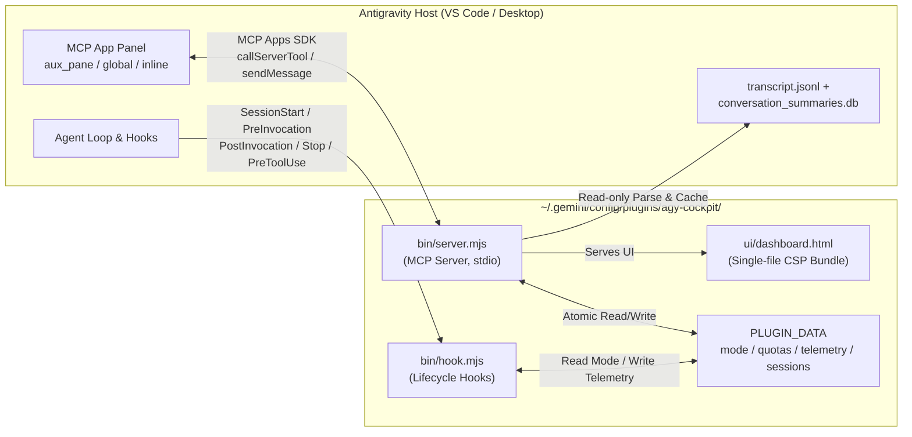

<div align="center">



<h1>Agy Cockpit</h1>

<p><strong>Status Telemetry &amp; Execution Mode Cockpit for Google Antigravity</strong></p>

<p>
  Context Window Gauge &amp; Hover Breakdown · Cache Hit Rate · Latency &amp; Speed Curves · 5h / 7d Token Quotas · Normal / Plan / Ask / Turbo Switcher
</p>

<p>
  
  <a href="https://github.com/muamuauh/agy-cockpit/actions/workflows/ci.yml">
    
  </a>
  <a href="./LICENSE">
    
  </a>
  
  
  
</p>

<p>
  <a href="./README.md">简体中文</a> | <strong>English</strong>
</p>

<p>
  <a href="#features">Features</a> |
  <a href="#execution-modes">Execution Modes</a> |
  <a href="#quick-install">Quick Install</a> |
  <a href="#architecture">Architecture</a> |
  <a href="#development--testing">Development</a> |
  <a href="#privacy--uninstall">Privacy &amp; Uninstall</a>
</p>

</div>

---

> **Design Principle**: Built strictly on Antigravity's official extension architecture (**MCP App + Lifecycle Hooks + Native Plugin**). No binary patching, no native DOM injection, and no probing of undocumented internal host services. Works seamlessly across both the **VS Code Antigravity Extension** and **Antigravity 2.0 Desktop**, packaged as self-contained bundles with zero runtime `node_modules`.

## Features

| Module | Capabilities |
| :--- | :--- |
| **Context Gauge & Hover Breakdown** | Color-coded SVG context ring (`<60%` green / `60%–85%` amber / `≥85%` red), exact `used / limit`, cache hit rate, and session totals. **Hover or click the ring** for a 4-category stacked breakdown (System & Tools, Tool Outputs / Files, Assistant & Tool Args, User & System Messages), compaction count, estimated remaining turns, and Top-4 tool consumers. |
| **Project → Session Filtering** | Read-only SQLite lookup of `conversation_summaries.db` to display human-readable `Title (Project)` labels while filtering out subagents and `/btw` sidebar questions. Single-row cascading **Project → Session** dropdowns fit cleanly even in narrow sidebars. |
| **4-Tier Execution Mode Switcher** | Instant toggle between **`Normal` / `Plan` / `Ask` / `Turbo`** enforced by `hooks.json`. Mode mutations use an app-only tool (`visibility: ["app"]`) hidden from the model. Includes one-click `/plan`, `/compact`, and `/grill-me` quick actions. |
| **Latency & Speed Telemetry** | Combines millisecond Hook timing with pure-model transcript deltas (preventing long tool/approval waits from distorting `tok/s`), displaying latest/avg/P95 latency, latest/avg/peak speed, and a responsive 1:1 SVG 24-turn trend chart. |
| **5h / 7d Token Usage & Quotas** | Aggregates local tokens across all conversations for **5-hour rolling**, **7-day weekly**, and **all-time** windows, showing `% left` bars, rolling reset countdowns, 7-day daily bars, and `Gemini` vs `Claude/GPT` pool splits. Supports independent budgets for non-cached vs total tokens plus one-click calibration from official `View Usage` percentages. |

---

## Execution Modes

Agy Cockpit acts as an upper-layer hook controller layered cleanly above Antigravity's native **Global Permissions** preset (it can tighten permissions on the fly without ever bypassing host sandbox or security boundaries):

| Mode | `PreInvocation` | `PreToolUse` | Best For |
| :--- | :--- | :--- | :--- |
| **`Normal`** | Telemetry only | Returns `allow` so host preset & sandbox govern execution | Everyday default |
| **`Plan`** | Injects read-only planning directive | Hard-blocks (`deny`) `edit_file`, `write_file`, `run_command` | Architecture design & read-only audits |
| **`Ask`** | Telemetry only | Forces approval (`force_ask`, ignoring Always Allow cache) | High-stakes edits & production repos |
| **`Turbo`** | Injects batched autonomous execution directive (preserving safety redlines) | Allows mutating, shell, MCP & web tools | Fast in-workspace iteration (pairs great with native `Auto`) |

---

## Quick Install

### Prerequisites
- **Node.js `>= 20`** (`>= 22.5` recommended for built-in `node:sqlite` session title/project lookup; gracefully falls back on older Node versions)
- **Antigravity VS Code Extension** or **Antigravity 2.0 Desktop**

### Option 1: Agent-Assisted Install
Send this prompt directly to Antigravity:

```text
Please clone and install the Agy Cockpit plugin from https://github.com/muamuauh/agy-cockpit:
run npm install, npm test, and npm run install-plugin, then refresh the MCP server.
```

### Option 2: Manual Install

```bash
git clone https://github.com/muamuauh/agy-cockpit.git
cd agy-cockpit
npm install
npm run install-plugin
```

The built plugin is synced to `~/.gemini/config/plugins/agy-cockpit/` (`%USERPROFILE%\.gemini\config\plugins\agy-cockpit\` on Windows).

### Opening the Dashboard
- **Right Side Pane (recommended)**: Click **`+`** in the auxiliary pane → **`Agy Cockpit`**
- **Left Sidebar**: Open **`Agy Cockpit`** full-page view
- **Inline**: Ask the agent to *"Open Agy Cockpit"*

---

## Architecture



---

## Development & Testing

```bash
# Bundle server, hook, and single-file HTML dashboard to dist/plugin/
npm run build

# Run unit tests and end-to-end MCP smoke tests
npm test

# Build and sync in-place to ~/.gemini/config/plugins/agy-cockpit/
npm run install-plugin
```

---

## Privacy & Uninstall

- **100% Local & Read-Only**: All telemetry is parsed locally from `~/.gemini/` logs and read-only SQLite databases with zero outbound network requests and strict CSP compliance.
- **Uninstall**: Disable or remove `agy-cockpit` from **Customizations → Installed**, or delete the plugin folder:

```powershell
# Windows (PowerShell)
Remove-Item -Recurse -Force "$env:USERPROFILE\.gemini\config\plugins\agy-cockpit"
```

```bash
# macOS / Linux
rm -rf ~/.gemini/config/plugins/agy-cockpit
```

---

## License

[MIT](./LICENSE) © 2026 [muamuauh](https://github.com/muamuauh)
